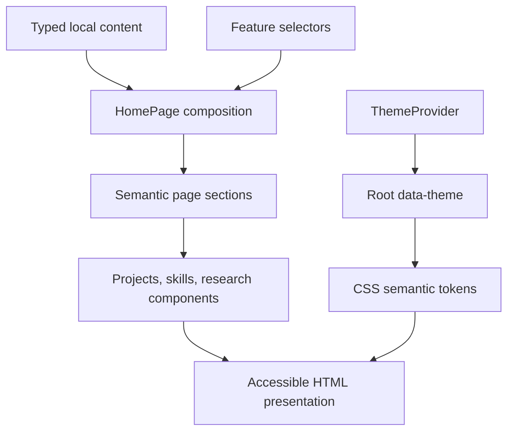

# Phase 1.2 — Detailed Technical Architecture Design

**Status:** Finalized proposal; ready for user approval. Documentation only; no app or dependencies were created.  
**Baseline:** Approved direction from the user and repository findings in [Phase 1.1](PHASE_1_1_REPOSITORY_AUDIT.md).  
**Canonical visual reference:** [portfolio-concepts.html](../../prototypes/portfolio-concepts.html)

## 1. Executive summary

Initialize this currently source-empty checkout as a React single-page application with Vite and TypeScript, using npm, after the user approves Phase 2. The first release is one route with section anchors. Store authored portfolio content in typed TypeScript modules. Render repeated content from data through reusable, accessible feature components.

The initial design has a semantic token layer for the approved light and dark palettes, and a single ThemeProvider that presents System, Light, and Dark preferences. System is the default; explicit Light or Dark choices persist across sessions. Project, skill, research, education, experience, profile, and link records have stable IDs and domain-owned types. Only verified, owner-supplied content is included. Project cards consume records; a new project is added to content data, not by writing new JSX.

Do not add routing, filtering, search, localization, a CMS, analytics, a contact form, or animation libraries now. Keep boundaries that let those features be added when their content and user flows are approved.

React’s current documentation recommends considering a React framework for production applications and also documents building from scratch with Vite when the constraints justify it. This architecture follows the user-approved React + Vite direction for the initial static portfolio; revisit the rendering/platform choice if server rendering, static generation, or richer publishing becomes a requirement. [React: Creating a React App](https://react.dev/learn/creating-a-react-app), [React: Build a React App from Scratch](https://react.dev/learn/build-a-react-app-from-scratch)

## 2. System boundaries and overview

### In scope for the initial app

- A single homepage and section navigation.
- Approved Hero, About, Technical Skills, Selected Projects, Research & Technical Interests, Education & Experience, Contact, and Footer content.
- Conceptual Systems Diagram as a semantic, responsive visual; it is not an infrastructure status view.
- English content and System, Light, and Dark theme preferences (with Light and Dark appearances).
- Typed local content and data-driven repeated components.
- Accessible mobile navigation, theme control, project evidence links, and optional project media.

### Outside the initial application boundary

No server, API, CMS, user accounts, content editor, search index, analytics, contact-form backend, blog, project routes, or Japanese translation is assumed. Until verified content is supplied, content collections are empty and content-dependent sections are omitted. The static prototype files remain in prototypes/ and are not imported into the React bundle.

### Layers and data flow

    authored content + imported assets
                 │
                 ▼
       feature types and selectors
                 │
                 ▼
     HomePage composes page sections
                 │
                 ▼
  section components pass typed props
                 │
                 ▼
     semantic feature/UI components
                 │
                 ▼
      browser DOM + CSS custom properties

Theme state follows a parallel path:

    OS color preference ─┐
                         ├─> ThemeProvider ─> root data-theme ─> theme tokens
    saved Light/Dark ────┘          │
                                    └─> theme-color metadata

### Component composition

    App
    └── ThemeProvider
        └── HomePage
            ├── SiteHeader
            ├── main
            │   ├── HeroSection
            │   ├── AboutSection
            │   ├── SkillsSection ──> SkillGroup
            │   ├── ProjectsSection ──> ProjectList ──> ProjectCard
            │   ├── ResearchSection
            │   ├── ExperienceSection
            │   └── ContactSection
            └── SiteFooter

    SiteHeader ──> ThemeControl

The page composition owns the content imports. Sections receive typed values through props. Feature components receive one record or collection and render it. Feature selectors own data transformations such as featured ordering; they do not fetch content or store presentation state. A shared section-visibility decision derived from meaningful records controls both each section and its navigation item, so users never encounter a dead anchor or an empty heading. The Hero is the sole exception: it always presents the approved career direction and conceptual diagram, and includes name/introduction only when verified data exists.

## 3. Proposed initial folder structure

This tree is a target after a separately approved implementation phase. It is not present in the repository now. Add only folders that receive real files.

    portfolio/
    ├── index.html
    ├── vite.config.ts
    ├── tsconfig.json
    ├── tsconfig.app.json
    ├── tsconfig.node.json
    ├── package.json
    ├── src/
    │   ├── main.tsx
    │   ├── app/
    │   │   ├── App.tsx
    │   │   └── providers/
    │   │       └── ThemeProvider.tsx
    │   ├── pages/
    │   │   └── HomePage.tsx
    │   ├── components/
    │   │   ├── layout/
    │   │   │   ├── SiteHeader.tsx
    │   │   │   ├── SiteFooter.tsx
    │   │   │   └── SkipLink.tsx
    │   │   └── ui/
    │   │       └── ThemeControl.tsx
    │   ├── sections/
    │   │   ├── HeroSection.tsx
    │   │   ├── AboutSection.tsx
    │   │   ├── SkillsSection.tsx
    │   │   ├── ProjectsSection.tsx
    │   │   ├── ResearchSection.tsx
    │   │   ├── ExperienceSection.tsx
    │   │   └── ContactSection.tsx
    │   ├── features/
    │   │   ├── profile/
    │   │   │   └── types.ts
    │   │   ├── projects/
    │   │   │   ├── types.ts
    │   │   │   ├── ProjectCard.tsx
    │   │   │   ├── ProjectList.tsx
    │   │   │   └── projectSelectors.ts
    │   │   ├── skills/
    │   │   │   ├── types.ts
    │   │   │   └── SkillGroup.tsx
    │   │   ├── research/
    │   │   │   └── types.ts
    │   │   └── experience/
    │   │       └── types.ts
    │   ├── content/
    │   │   ├── profile.ts
    │   │   ├── projects.ts
    │   │   ├── projectCategories.ts
    │   │   ├── skills.ts
    │   │   ├── skillCategories.ts
    │   │   ├── research.ts
    │   │   ├── education.ts
    │   │   ├── experience.ts
    │   │   └── socialLinks.ts
    │   ├── hooks/
    │   │   └── useTheme.ts
    │   └── styles/
    │       ├── tokens.css
    │       ├── theme.css
    │       └── global.css
    ├── public/                 # only if real static assets need stable URLs
    ├── prototypes/
    └── docs/
        └── architecture/

Create public/ only if a verified asset needs a stable root URL. Project images should normally be imported from a future src/assets/projects/ directory when real image records are added; do not create placeholder assets or empty directories. Vite’s public directory is for files needing stable root URLs, rather than imported/transformed assets.

### Folder responsibilities and dependency rules

| Folder | Owns / belongs here | Does not own | May depend on |
| --- | --- | --- | --- |
| app/ | App composition, app-wide providers, later route outlet | Portfolio copy, project rendering details, global styles | pages, providers, shared components |
| app/providers/ | Theme state and app-wide provider wiring | Per-section display logic or content records | hooks/types and browser APIs |
| pages/ | Page-level content assembly and page-specific ordering | Duplicated content records or low-level theme storage | sections, content, feature selectors |
| components/layout/ | Header, footer, skip link, shared site frame | Projects or skills data/model rules | ui controls, shared types |
| components/ui/ | Reusable interaction controls such as ThemeControl | Page composition, data retrieval, domain entities | hooks and design tokens |
| sections/ | Semantic section structure and section heading/intro | Reimplementing repeated cards or owning duplicated records | features, content-facing props, shared layout/UI |
| features/projects/ | Project types, selectors, list/card presentation | Global navigation, all app routing, profile content | project types and shared UI/tokens |
| features/skills/ | Skill and category types; reusable skill grouping | Project card markup or theme persistence | skill types and shared UI/tokens |
| features/research/ | Research record type and any research-specific presentation added with real needs | Publication claims or unrelated page shell | research types and shared tokens |
| features/experience/ | Education/experience types and future repeated timeline item | Profile identity and global shell | its types and shared tokens |
| features/profile/ | Profile and social-link types | Page data ownership or contact service integrations | shared content types if needed |
| content/ | Authored typed arrays and profile records | JSX, CSS, browser state, fetch calls | feature-owned types and asset imports |
| hooks/ | Reusable React behavior such as useTheme context access | Content records or presentational markup | providers and browser APIs |
| styles/ | Global reset, semantic tokens, theme selectors, typography foundations | Per-record branching or data | No React modules; consumed by components |
| public/ | Existing static files needing stable root URLs, such as a real favicon | Imported project galleries or placeholder media | Browser URL resolution only |
| prototypes/ | Isolated standalone design artifacts | Production imports or application dependencies | No src/ dependency |
| docs/architecture/ | Architecture and decision documents | Runtime content or source code | Markdown references to project docs |

If a feature type or component is not yet justified by an actual record or repeated UI, keep it small and colocated rather than creating placeholder modules. Avoid barrel exports until they solve real import complexity.

## 4. Component responsibilities and interfaces

These are conceptual TypeScript interfaces for implementation; they do not create files. Types may be adjusted while preserving the boundaries below.

    import type { ReactElement, ReactNode } from "react";

    type NavItem = { id: string; label: string; href: string };

    function App(): ReactElement;
    function HomePage(): ReactElement;
    function SiteHeader(props: { name?: string; items: NavItem[] }): ReactElement;
    function SiteFooter(props: { name?: string; year?: number }): ReactElement;
    function HeroSection(props: { profile: Profile }): ReactElement;
    function AboutSection(props: { profile: Profile }): ReactElement;
    function SkillsSection(props: {
      skills: Skill[];
      categories: SkillCategory[];
    }): ReactElement;
    function ProjectsSection(props: {
      projects: Project[];
      categories: ProjectCategory[];
    }): ReactElement;
    function ProjectList(props: {
      projects: Project[];
      featuredProjectIds?: string[];
    }): ReactElement;
    function ProjectCard(props: {
      project: Project;
      emphasis?: "featured" | "standard";
    }): ReactElement;
    function ResearchSection(props: {
      items: ResearchItem[];
      interests: string[];
    }): ReactElement;
    function ExperienceSection(props: {
      education: Education[];
      experience: Experience[];
    }): ReactElement;
    function ContactSection(props: {
      email?: string;
      links: SocialLink[];
    }): ReactElement;
    function SkillGroup(props: {
      category: SkillCategory;
      skills: Skill[];
    }): ReactElement;
    function ThemeControl(): ReactElement;
    function ThemeProvider(props: { children: ReactNode }): ReactElement;

### Component contracts

| Component | Responsibility and state ownership |
| --- | --- |
| App | Wrap the page in ThemeProvider and render HomePage. Add a route outlet only after routing is approved. No content arrays or project logic in App. |
| HomePage | Import authored content modules, derive which sections contain meaningful content, build section navigation from the same visibility decisions, pass values into sections, and preserve the approved reading order. No theme persistence logic. |
| SiteHeader | Render site identity and section links. Own only local mobile-menu open/closed state, Escape handling, link-close behavior, and ARIA state. Does not own theme state. |
| SiteFooter | Render only verified identity and footer links; omit absent fields and omit the footer region if nothing meaningful remains. No repeated full navigation or uptime-like status decoration. |
| HeroSection | Render the approved role direction and conceptual diagram, plus profile name/introduction only when verified. Show section CTAs only when their target sections are visible. Diagram labels remain visible and understandable without color or animation. |
| AboutSection | Present profile summary, working approach, and actual interests from Profile data. Omit absent optional rows; hide the entire section if no meaningful profile/about content remains. |
| SkillsSection | Group Skill records using SkillCategory data and show context/evidence where supplied. No proficiency classification inferred by UI. Hide when no skills exist. |
| ProjectsSection | Provide section heading and intro, compute or receive project ordering, and delegate repeated records to ProjectList. Omit the section and its anchor link when there is no meaningful published project content. |
| ProjectList | Map any collection size to ProjectCard using stable IDs. No two/three-item assumptions or hand-authored card branches. |
| ProjectCard | Present the project summary, categories, tags, optional image and factual evidence links. Hide absent fields and links. Project detail pages may use the same metadata/presentation primitives without forcing detail layout into card markup. |
| ResearchSection | Render ResearchItem records and optional technical-interest terms. Status comes from data and must not be inferred. Hide if both research and interests are absent. |
| ExperienceSection | Present education and experience records in a consistent chronological pattern; omit empty groups and unavailable fields. Hide if both are empty. |
| ContactSection | Render only verified email/social links. Hide if no verified contact method exists. No form state or backend unless separately approved. |
| SkillGroup | Render one category and its matching skill records. A category with no skills is omitted from public UI. |
| ThemeControl | Read and update ThemeProvider preference through an accessible three-choice control: System, Light, Dark. Expose the selected preference and keep the effective theme distinguishable for assistive technology. |
| ThemeProvider | Own system/manual preference resolution, storage access, media-query subscription, root data-theme, and theme-color metadata. Expose a small context contract through useTheme. |

### Data ownership and dependency direction

- content modules are the source of authored records.
- HomePage imports content and passes values down.
- Section components own section-specific composition only.
- Feature components own repeated domain presentation and selectors.
- No child component reaches back into the content directory to retrieve global data.
- Theme state flows through context; colors flow through CSS custom properties. Components do not pass color values as props.

## 5. Content storage, model, and rendering

### Storage and validation

Use TypeScript modules for the initial authored content. Keep data outside JSX; import asset URLs where real local images exist. Type arrays with feature-owned interfaces and the TypeScript satisfies operator. TypeScript checks local object shape at build time, but it does not validate data loaded dynamically at runtime.

Do not add placeholder or fabricated records to production arrays. The placeholder examples below are for design documentation only. Public content modules contain only owner-supplied, verified records; drafts remain outside the public content boundary. Before a real record is included, verify each claim and URL. If a CMS or API is later introduced, validate its payload at the adapter boundary and map provider-specific fields into these internal models.

### Categories, tags, and featured ordering

- A ProjectCategory is a controlled, browsable group such as a real engineering domain. It has a stable ID, a reader-facing label, optional description, and order.
- A tag is a flexible descriptive label attached to a project, usually a technology or method. Tags do not establish proficiency.
- Category IDs connect a project to its controlled category entries. Tags remain strings initially; promote them to a controlled taxonomy only if filtering or reporting requires it.
- Featured ordering should allow zero, one, or many featured records. Use optional featuredOrder rather than a fixed featured boolean if more than one ranked project may be featured. Lower order numbers appear first; absent values mean not featured.
- IDs remain stable when a title changes. Slugs should be unique and URL-safe; future localized routes may map locale-specific slugs to the stable project ID.

### Proposed model

Types belong to their feature: Project and ProjectCategory in features/projects/types.ts; Skill and SkillCategory in features/skills/types.ts; ResearchItem in features/research/types.ts; Profile and SocialLink in features/profile/types.ts; Education and Experience in features/experience/types.ts. ProjectLink is project-owned; ResearchItem uses an equivalent ResearchLink type unless a genuinely shared ExternalLink type emerges. Do not create a global types directory just to collect every type.

Every bracketed value is an explicit placeholder, not real content.

    export type ProjectImage = {
      src: string;                 // "[Imported local asset or verified image URL]"
      alt: string;                 // "[Accurate description of the actual image]"
      caption?: string;            // "[Optional factual caption]"
      width?: number;
      height?: number;
    };

    export type ProjectLink = {
      id: string;                  // "[link-id]"
      label: string;               // "[Repository, demo, documentation, or publication]"
      href: string;                // "[Verified URL; never a placeholder anchor]"
      kind: "repository" | "demo" | "documentation" | "publication" | "other";
    };

    export type ProjectCategory = {
      id: string;                  // "[category-id]"
      label: string;               // "[Category label]"
      description?: string;        // "[Optional explanation]"
      order: number;
    };

    export type Project = {
      id: string;                  // "[stable-project-id]"
      slug: string;                // "[project-detail-slug]"
      title: string;               // "[Verified project title]"
      summary: string;              // "[Verified concise summary]"
      featuredOrder?: number;      // "[Optional ranking; omit if not featured]"
      categoryIds: string[];      // ["[category-id]"]
      tags: string[];              // ["[verified technology or topic]"]
      problem?: string;            // "[Verified problem and constraints]"
      approach?: string;           // "[Verified engineering approach]"
      contribution?: string;       // "[Your verified contribution and team context]"
      outcome?: string;            // "[Verified attributable outcome; omit if unavailable]"
      links: ProjectLink[];        // [] when no public evidence link exists
      images?: ProjectImage[];     // Omit when no verified visual asset exists
      relatedSkillIds?: string[];
    };

    export type SkillCategory = {
      id: string;                  // "[skill-domain-id]"
      label: string;               // "[Technical domain]"
      order: number;
    };

    export type Skill = {
      id: string;                  // "[skill-id]"
      categoryId: string;          // "[skill-domain-id]"
      name: string;                // "[Technology or practice]"
      context?: string;            // "[Verified usage context]"
      relatedProjectIds?: string[];
    };

    export type ResearchLink = {
      id: string;                  // "[research-link-id]"
      label: string;               // "[Paper, poster, presentation, or code]"
      href: string;                // "[Verified URL]"
      kind: "paper" | "poster" | "presentation" | "code" | "other";
    };

    export type ResearchItem = {
      id: string;                  // "[research-id]"
      title: string;               // "[Verified topic]"
      status: "in-progress" | "submitted" | "published" | "completed";
      objective?: string;          // "[Verified objective]"
      method?: string;             // "[Verified method]"
      contribution?: string;       // "[Verified contribution and collaborators]"
      dateLabel?: string;          // "[Verified date or range]"
      links: ResearchLink[];       // [] when none are public
    };

    export type Education = {
      id: string;                  // "[education-id]"
      institution: string;          // "[Verified institution]"
      qualification: string;       // "[Verified qualification]"
      field?: string;              // "[Verified field]"
      startDate?: string;          // "[YYYY-MM]"
      endDate?: string | null;     // "[YYYY-MM or null when ongoing]"
      details?: string;            // "[Verified relevant detail]"
    };

    export type Experience = {
      id: string;                  // "[experience-id]"
      organization: string;        // "[Verified organization]"
      role: string;                // "[Verified role]"
      startDate: string;           // "[YYYY-MM]"
      endDate?: string;            // "[YYYY-MM; omit when current]"
      summary: string;             // "[Verified scope and responsibilities]"
      projectIds?: string[];
    };

    export type SocialLink = {
      id: string;                  // "[social-link-id]"
      platform: "github" | "linkedin" | "website" | "other";
      label: string;               // "[Verified public label]"
      href: string;                // "[Verified profile URL]"
      order: number;
    };

    export type Profile = {
      name?: string;               // "[Verified name]"
      introduction?: string;      // "[Verified introduction]"
      about?: string;              // "[Verified background and approach]"
      technicalInterests?: string[];
      location?: string;           // "[Optional verified location]"
      email?: string;              // "[Optional verified contact email]"
    };

ResearchLink is the same four-field shape as ProjectLink except its kind values describe research evidence. If this duplication becomes meaningful, extract a shared ExternalLink type into src/types/links.ts; do not add that abstraction before it is used in multiple domains.

### Repeated content and empty/edge behavior

| Data condition | Required behavior |
| --- | --- |
| Empty content collection | Omit that section and its navigation link consistently when no meaningful, verified content exists. Do not substitute invented copy or a generic empty-state message. The Hero remains the page entry point and contains only the approved career direction, conceptual diagram, and any verified profile fields available. |
| Many projects | Map records by stable ID; never branch on collection length or encode a fixed card count. Initially show authored records without search/filter UI. If the collection becomes difficult to browse or costly to render, measure and then choose approved filtering, pagination, or virtualization; no library is selected now. |
| No image | Omit the image/gallery block and its spacing. Do not render broken-image icons or invented artwork. |
| Optional field absent | Omit the label and row; do not leave an empty line, dash, or fabricated default. |
| No link | Do not render a disabled or placeholder anchor. Include a link record only after its destination is verified and approved for publication. |
| Category with no projects | Omit the category from visible filters/navigation. In the unfiltered homepage, do not create an empty category group. |
| Invalid reference or duplicate ID/slug | Treat as a content integrity error. Add a small data validation check when implementation/testing is approved; do not silently display incorrect relations. |
| Long names, titles, tags, URLs, CJK text | Allow wrapping; use min-width: 0, minmax(0, 1fr), and overflow-wrap: anywhere where appropriate. Never truncate essential identifiers without another way to access the full text. |

This policy follows the content resilience cases in break-ui without adding its dev-only toggle or inventing test data during architecture design.

## 6. Future project detail pages (not implemented now)

Keep stable project IDs and slugs in each record. When detail pages are approved:

1. Add an explicit router and route table. The project detail route resolves a slug to one Project from the same projects collection.
2. Add ProjectDetailPage as a page-level composition, not as an enlarged ProjectCard.
3. Reuse domain presentation primitives where semantics match: title/category metadata, evidence links, image gallery, and related projects.
4. Keep detail-only narrative sections in ProjectDetailPage or project feature components. The homepage card stays compact and continues to link to the detail page.
5. Render a clear not-found page for unknown slugs and preserve normal browser history, refresh, copy-link, and back-button behavior.
6. Configure the selected host’s deep-link fallback or static route generation, then verify direct visits and refreshes.

A route may look like /projects/[slug] in this proposal. The actual route syntax and host rules are implementation decisions after the hosting target and detail-page content are known. Do not create route files or install routing dependencies in this phase.

## 7. Theme architecture

### State model

    type ThemePreference = "system" | "light" | "dark";
    type EffectiveTheme = "light" | "dark";

- Initial preference is system unless a valid explicit localStorage value (`light` or `dark`) exists.
- Effective theme equals the explicit light/dark value, or the current matchMedia color-scheme result when preference is system.
- ThemeProvider is the only owner of preference state and storage. Consumers use useTheme rather than each owning a copy.
- Listen to OS preference changes only while preference is system. A manual preference remains stable when the OS changes.
- Persist explicit Light or Dark selection across sessions. If the user selects “System”, remove the stored override so subsequent OS preference changes apply.
- Apply the effective value to document.documentElement.dataset.theme and update theme-color metadata to match the page background.

### Avoiding a flash of the wrong theme

Add a short, defensive theme bootstrap in root index.html before the app stylesheet can paint. It reads the same storage key as ThemeProvider, falls back to matchMedia, validates allowed values, and sets the root data-theme. ThemeProvider then adopts that resolved preference as its initial state. Keep the boot script tiny, exception-safe, and in sync with provider logic; do not copy separate divergent theme rules into sections. If a strict Content Security Policy later disallows inline script, use a nonce or an approved external early-loading script.

### Theme control contract

- Use a semantic button, not a styled div or checkbox.
- Provide three clearly named options: System, Light, and Dark. Use a native button group or select with an accessible selected state; do not force a binary toggle that cannot represent System.
- Support keyboard activation and a strong visible focus ring.
- Choosing System removes the stored override; choosing Light or Dark stores that preference. OS changes update appearance only while System is selected.
- Never rely on color alone to communicate the active mode.

### Semantic theme tokens

The following values come from the approved palette. Use them as semantic variables rather than hardcoded values within components.

| Token | Light | Dark |
| --- | --- | --- |
| Background | #F5F5F0 | #151A19 |
| Surface | #FFFFFF | #202927 |
| Muted surface | #EAECE5 | #29322F |
| Primary | #203D35 | #9DBDAE |
| Accent | #D97843 | #E49A69 |

Additional semantic tokens are needed for body text, muted text, subtle text, borders, focus ring, diagram grid/connector, and accent text. Derive and contrast-check those values in both schemes before implementation. The darker light-theme accent text may be a separate accessible token while retaining the approved orange accent for larger accents/decoration.

## 8. Styling architecture

### Token and stylesheet responsibilities

- styles/tokens.css: spacing, type scale, content widths, border radii, and motion-duration/easing values shared between themes.
- styles/theme.css: light/dark semantic color variables and color-scheme declaration on the root.
- styles/global.css: box sizing, page defaults, focus baseline, body typography, link defaults, and reduced-motion safe defaults.
- Component CSS: co-locate a small CSS file with a section/feature only when that component has meaningful layout rules. Keep CSS selectors scoped with component class prefixes. Do not create one global stylesheet full of per-project exceptions.
- Use plain CSS custom properties and CSS Grid/Flexbox. No styling framework is justified by the present component set.
- Use a system sans-serif for body copy with CJK fallbacks. Use a display serif selectively for editorial emphasis and monospace only for short technical metadata. Keep prose in readable proportional type.
- Use a consistent spacing scale in rem, fluid type/space with clamp where it preserves legibility, and a centered content width with a narrower prose measure.
- Use minmax(0, 1fr), min-width: 0, content-based heights, and overflow-wrap for variable content.
- Images preserve aspect ratio; project image metadata provides alt text, and no image is emitted when no real image exists.

### Responsive breakpoints

Use content-driven CSS, not user-agent detection. The canonical prototype currently uses 980px, 760px, and 560px breakpoints; treat these as starting thresholds, then adjust based on actual navigation and content fit.

| Approximate width | Layout intent |
| --- | --- |
| Above 980px | Wide editorial content; hero diagram and text can sit side by side |
| 761–980px | Compress gutters/columns; retain desktop navigation only while it fits |
| 561–760px | Stack hero, use accessible mobile navigation, reflow feature columns |
| 560px and below | Single-column content, stack project metadata, simplify diagram to a clear vertical flow |

At 320 CSS px and 200% zoom, text should remain readable without horizontal page overflow. Do not force a viewport-height hero. Use safe-area insets only if fixed edge-to-edge controls are later introduced. The selected prototype declares viewport-fit=cover, but this document does not require carrying that declaration into production.

### Motion and reduced motion

- Default to still content. Motion is optional and must have a functional reason.
- Keep ordinary press/hover feedback immediate; gate hover behind (hover: hover) and (pointer: fine).
- If the conceptual diagram uses connector reveal, keep the text and complete relation available before animation; the SVG connectors are supplementary.
- Prefer small named CSS transitions for simple feedback. Avoid a motion package unless an approved interaction needs spring/gesture physics or more complex coordination.
- Under prefers-reduced-motion: remove movement, reveal delays, and smooth scrolling; keep content visible and preserve meaningful state feedback.
- Do not make section visibility depend on IntersectionObserver. If it is unavailable or reduced motion is enabled, the full content still renders normally.
- Review any future nontrivial motion with the relevant motion skill; profile performance only when symptoms or measurements justify it.

## 9. Accessibility and responsive behavior

| Area | Architecture requirement |
| --- | --- |
| Document semantics | Root lang=en, one h1, header/nav/main/footer landmarks, and logical h2/h3 order. Use section labels tied to visible headings. |
| Keyboard | Native anchors/buttons, skip link, logical tab order, visible :focus-visible styles, Escape closes mobile nav and restores focus. No concept-switching shortcuts or keyboard traps. |
| Screen readers | Button names and expanded/pressed states remain accurate. Decorative SVG connectors are hidden from the accessibility tree; visible diagram nodes and a concise text description provide the relationship. |
| Diagram | Use figure/figcaption or a named group. Text nodes identify Network, Systems, Software, and Reliable Solutions; contrast and labels work without connector color. State clearly that it is conceptual, not live telemetry or production architecture. |
| Contrast | Verify body, muted text, small metadata, links, controls, borders needed to find controls, and focus indicators for both themes. Accent colors are not automatically suitable for small text. |
| Reduced motion | Respect prefers-reduced-motion in CSS and any JS animation observer. Do not hide content before entrance animations. |
| Mobile nav | Toggle button uses aria-expanded and aria-controls; menu links are real anchors; Escape and link activation close the menu; menu is usable with keyboard and touch. |
| Touch | Aim for 44px controls where practical; provide :active feedback. Gate hover by input capability, not device name. |
| Zoom and text size | Never disable browser zoom. Avoid fixed-height text, clipped glyphs, and fixed-width buttons. Recheck long Vietnamese/Japanese/English strings and 200% zoom. |
| Localization readiness | Initial lang is English. If Japanese is later added, set page/fragment language correctly, allow longer labels and names to wrap, and provide reviewed translations rather than machine-inferred personal claims. |
| External links | Use descriptive labels and meaningful target behavior; do not render placeholders as links. If opening a new tab, communicate that and use safe rel values. |

Responsive acceptance work belongs in implementation verification, not just CSS architecture: keyboard-only pass, screen-reader spot check, contrast checks, 320px and 200% zoom, mobile browser test on real hardware, theme test in both schemes, and reduced-motion test.

## 10. Dependency strategy

No packages are installed or verifiable in this repository. The proposed initial baseline is intentionally small.

| Package/category | Initial status | Reason / native alternative |
| --- | --- | --- |
| react | Required by approved stack | Component runtime |
| react-dom | Required by approved web stack | Browser DOM renderer |
| vite | Required by approved build/dev direction | Dev server and production bundling |
| @vitejs/plugin-react | Required for the chosen Vite React integration | Official plugin supplies React Fast Refresh; plain Vite covers many features, but React integration is the use case. [Vite plugin docs](https://vite.dev/plugins/) |
| typescript | Required by approved stack | Static type checking |
| @types/react / @types/react-dom | Use the declarations selected by the React TypeScript starter/template | TypeScript support for React APIs and JSX; verify in generated manifest during approved setup |
| UI component library | Not needed | Header links, buttons, cards, and details can use semantic native HTML and CSS |
| State manager | Not needed | One ThemeProvider and local mobile-menu state do not justify global state tooling |
| Router | Deferred | Section links are browser-native; add a router only when project detail routes are approved |
| Motion library | Not needed initially | CSS handles press/color/opacity changes; native scroll and static diagram need no package |
| i18n library | Deferred | English-only first release; choose after locale content and translation workflow are approved |
| Runtime schema library | Deferred | Compile-time TypeScript is enough for local authored files; validate external CMS/API payloads if that boundary appears |
| Search/filter library | Deferred | Pure in-memory selectors are enough if a future project collection needs basic filtering |
| Virtualization | Not selected | Reassess only for a genuinely long collection after measuring; choose an implementation approach only if real performance evidence warrants it |
| Contact form service | Deferred / not selected | A mailto link or verified email has no backend; a real form creates spam, privacy, validation, and service requirements |

The official Vite React plugin documentation currently identifies @vitejs/plugin-react as providing React Fast Refresh via Oxc. TypeScript’s strict option enables the strict type-checking family and is the recommended baseline for the app config. [Vite plugins](https://vite.dev/plugins/), [TypeScript strict option](https://www.typescriptlang.org/tsconfig/strict)

The library-selection skill was reviewed. It does not justify installing a component library for this UI. Any future large-list solution remains an evidence-based decision; no library is preselected.

## 11. Future expansion boundaries

| Future capability | Boundary and reuse | Trigger to implement |
| --- | --- | --- |
| Project filtering/search | Add pure project selectors and section controls in features/projects; put filters in the URL only if shareable navigation is useful | Collection size or recruiter workflow makes browsing difficult |
| Project detail pages | Add ProjectDetailPage and a route resolving the same Project data by stable slug; share factual metadata/gallery components | A real project needs more detail than a card |
| Japanese localization | Add locale UI dictionaries plus localized content keyed by stable IDs; expose correct lang and an approved locale URL strategy | Japanese copy and review owner are confirmed |
| Technical blog | Add an independent Post model and blog feature/routes; do not reuse Project for articles | Real articles are ready to publish |
| API/CMS | Add a provider adapter and runtime validation that maps remote records into internal types | Manual local editing becomes a bottleneck |
| Analytics | Add a small, privacy-conscious integration with purpose and consent decisions | The owner approves measurement goals and privacy behavior |
| Contact form | Add a separate form feature and backend/provider integration; define spam, privacy, validation, and success/error behavior | A form is preferred over direct verified email |
| More content types | Add one owned model and focused presentation feature at a time | Real content and visitor value exist |

Do not pre-create these folders, routes, services, or dependencies now. Keep the initial code path simple so future expansion is additive rather than a rewrite.

## 12. Architecture Decision Records

The ADRs below capture decisions proposed by this architecture. They are ready for review and do not authorize implementation.

| ADR | Decision |
| --- | --- |
| [0001 — React, Vite, TypeScript](adr/0001-react-vite-typescript.md) | Initialize the current checkout with React + React DOM, Vite, TypeScript, and npm after approval; revisit rendering framework if requirements change. |
| [0002 — Single page, no router initially](adr/0002-single-page-no-router.md) | Use one HomePage and fragment navigation; add routes only for approved detail pages. |
| [0003 — Data-driven portfolio content](adr/0003-data-driven-content.md) | Render unbounded project and skill collections from typed records, not fixed JSX cards. |
| [0004 — Feature-oriented modules](adr/0004-feature-oriented-modules.md) | Organize domain types/presentation by feature and page assembly by section; keep abstractions small. |
| [0005 — CSS custom properties for themes](adr/0005-css-custom-properties-theming.md) | Use semantic CSS variables as the theme contract. |
| [0006 — System, Light, and Dark themes](adr/0006-system-theme-persisted-override.md) | Default to System; persist explicit Light/Dark preference; allow return to System. |
| [0007 — Local TypeScript content source](adr/0007-local-typescript-content.md) | Use authored TS modules first; validate at runtime only when an external content boundary appears. |
| [0008 — Defer API/CMS and localization](adr/0008-defer-api-cms-localization.md) | Keep initial content English/local and defer external content and Japanese until workflows are approved. |
| [0009 — Canonical prototype selection](adr/0009-canonical-prototype.md) | Use portfolio-concepts.html as the canonical approved visual reference and preserve all other prototypes. |

## 13. Phase 1.1 traceability

| Phase 1.1 requirement/finding | Architecture response | Trace |
| --- | --- | --- |
| No application or dependencies exist; current checkout is the target | Initialize the app in this checkout only after approval; use npm and approved stack | Sections 1, 3, 10; ADR 0001 |
| Approved Hybrid design and palettes | Canonical prototype plus semantic theme tokens and diagram requirements | Sections 1, 7–9; ADR 0005, 0009 |
| Single-page initially, future multi-page | Fragment links now; stable project slugs and route extension later | Sections 3, 6, 11–12; ADR 0002 |
| Many projects without JSX rewrites | Typed project arrays, stable IDs, ProjectList/ProjectCard, selectors | Sections 4–5; ADR 0003 |
| Categories, tags, featured projects | Normalized category records, flexible tags, rank-based featured order | Section 5; ADR 0003 |
| Skills, research, education, experience | Domain types and section props; omit empty sections/nav consistently | Sections 3–5 |
| No invented facts or URLs | Explicit placeholder examples, optional fields, publish gate, no placeholder anchors | Sections 5 and 9; ADR 0007 |
| Future images/galleries | Optional ProjectImage collection and asset boundary | Sections 3 and 5 |
| Clear separation of concerns | Page composition, sections, feature UI, content, provider, and styles separated | Sections 2–4; ADR 0004 |
| Accessible responsive design | Semantic contracts, contrast/focus/reduced motion/mobile behavior, responsive thresholds | Sections 8–9 |
| Avoid premature dependencies | Native HTML/CSS and minimal baseline; trigger-based future package decisions | Section 10 |
| English first, Japan-aware future | English metadata now, localization boundary and reviewed Japanese content later | Sections 8, 12; ADR 0008 |
| Prototype isolation and canonical choice | Selected prototype is sole design source; other prototypes untouched | Sections 1, 3, 14; ADR 0009 |
| No production implementation in audit phases | This document and ADRs specify a plan only; no app code or package changes | Sections 14 and 16 |

## 14. Remaining inputs and unresolved issues

The architectural direction is consistent and ready for user approval. These content/operational inputs remain open and do not change the baseline:

1. Verified profile, projects, skills/evidence, research, education, experience, images, and contact details must be supplied before those sections or records can appear. No records will be fabricated to fill the page.
2. Browser support targets and hosting provider are not specified. Confirm them when implementation/deployment requirements demand concrete compatibility or routing decisions; the initial page requires no client router.
3. Japanese copy and a localization workflow are not supplied. Initial metadata and content remain English.

The project target, fresh initialization in this audited checkout, npm, System/Light/Dark behavior, no initial router, and uniform empty-section behavior are settled by the current request.

## 15. Skills read and applied

Skill paths were verified under /home/trananhduc_20233337/.agents/skills/. The complete SKILL_USAGE_PLAN.md and Phase 1.1 audit were read before this design. The complete skill guidance below was read and applied only where its trigger matched.

| Skill | Phase 1.2 use | Decisions it influenced |
| --- | --- | --- |
| apple-design | Consulted and applied as an architecture lens | Purpose, visitor agency, familiar navigation, typography, reduced motion, contrast, and restraint; no gestures or translucency are required for this portfolio. |
| emil-design-eng | Consulted and applied as a craft lens | Explicit component ownership, immediate interaction feedback, and motion/dependency restraint. |
| mobile-native | Consulted for responsive/mobile constraints | Capability-based hover, touch targets, zoom, no unnecessary safe-area metadata, and real-device verification boundary. |
| break-ui | Consulted for data-state policy; workflow not invoked | Empty collections, absent optional values, long/CJK strings, URLs, missing media, and large collections; no test fixture or toggle was added. |
| pick-ui-library | Consulted to confirm dependency restraint; no library selected | Current semantic controls need no library; revisit only for a concrete UI need or measured large-list problem. |
| animate | Installed; not invoked | No new motion implementation is requested. Motion policy is covered by the design skills and existing plan. |
| review-animations | Installed; not invoked | This is architecture design, not a review of an animation diff. Invoke if nontrivial motion is implemented later. |
| animation-performance | Installed; not invoked | No jank symptom or performance recording is available. |
| prototype | Installed; not invoked | The canonical direction is already approved; no variant exploration is needed. |
| Other skills in the 16-skill plan | Not applicable to this web architecture phase | In particular animate-expo and write-swift are outside the selected stack. |

No skill was unavailable. No bundled companion references were required for the decisions made here; implementation-triggered companion recipes remain for the implementation phase.

## 16. References

- [Phase 1.1 repository audit](PHASE_1_1_REPOSITORY_AUDIT.md)
- [Skill usage plan](../SKILL_USAGE_PLAN.md)
- [Canonical Hybrid prototype](../../prototypes/portfolio-concepts.html)
- [React: Creating a React App](https://react.dev/learn/creating-a-react-app)
- [React: Build a React App from Scratch](https://react.dev/learn/build-a-react-app-from-scratch)
- [Vite official plugins](https://vite.dev/plugins/)
- [Vite features](https://vite.dev/guide/features)
- [TypeScript strict option](https://www.typescriptlang.org/tsconfig/strict)

## 17. Scope confirmation

This document and its nine ADR files define an architecture proposal only. No src/ directory, React component, package manifest, dependency, configuration, prototype change, personal content, commit, or push was created or modified. Phase 1.2 documentation is superseded by the Phase 1.3 reconciliation; no application work is authorized until the user approves the finalized architecture and Phase 2.
